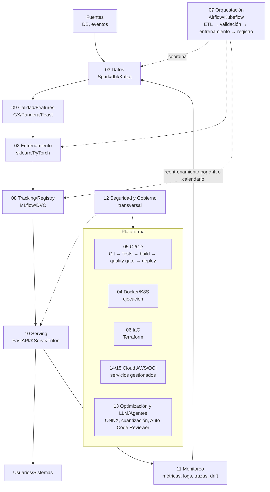

# Cheatsheets del stack MLOps: índice y roadmap de aprendizaje

Complemento de [mlops-engineer-actividades.md](../mlops-engineer-actividades.md). Cada cheatsheet sigue la misma estructura:

**Para qué sirve** · **Escenario de uso** · **Comandos típicos** · **Variantes** · **Requisitos técnicos y de conocimiento** · **Conexión con el stack** · **Aprende más** · **Hilando soluciones** (ejemplo de arquitectura que combina piezas)

---

## Índice por naturaleza

| # | Cheatsheet | Naturaleza | Contenido |
|---|---|---|---|
| 01 | [Lenguajes](01-lenguajes.md) | Fundamento | Python, SQL, Bash, Go/Java |
| 02 | [Frameworks de ML](02-frameworks-ml.md) | Construcción de modelos | scikit-learn, XGBoost/LightGBM, PyTorch, TensorFlow |
| 03 | [Procesamiento de datos](03-procesamiento-datos.md) | Datos batch y streaming | Pandas/Polars, Spark, Kafka, dbt |
| 04 | [Contenedores y Kubernetes](04-contenedores-kubernetes.md) | Empaquetado y ejecución | Docker, Kubernetes, Helm, HPA/KEDA |
| 05 | [CI/CD](05-ci-cd.md) | Automatización de entrega | Git, GitHub Actions, GitLab CI, Jenkins, Azure DevOps, GitOps |
| 06 | [Infraestructura como código](06-iac.md) | Provisión de infraestructura | Terraform, Pulumi, Ansible |
| 07 | [Orquestación de pipelines](07-orquestacion-pipelines.md) | Coordinación de flujos | Airflow, Kubeflow Pipelines, Argo Workflows, Prefect, Dagster |
| 08 | [Versionado y tracking](08-versionado-tracking.md) | Trazabilidad y reproducibilidad | MLflow, DVC, W&B, model registry |
| 09 | [Feature store y calidad de datos](09-feature-store-calidad.md) | Confiabilidad de datos | Feast, Great Expectations, Pandera, Deepchecks |
| 10 | [Serving](10-serving.md) | Exposición del modelo | FastAPI, BentoML, KServe, Seldon, Triton, TorchServe |
| 11 | [Monitoreo y observabilidad](11-monitoreo-observabilidad.md) | Visibilidad en producción | Prometheus, Grafana, ELK/OpenSearch, OpenTelemetry, Evidently, WhyLabs, SRE |
| 12 | [Seguridad y gobierno](12-seguridad-gobierno.md) | Transversal | Vault, IAM/RBAC, Trivy, Snyk, SAST, auditoría, IA responsable |
| 13 | [Optimización y LLM/agentes](13-optimizacion-llm-agentes.md) | Avanzado | ONNX, cuantización, TensorRT, GPU, APIs LLM, RAG, LangGraph, MCP, evaluación |
| 14 | [Cloud: AWS + Azure/GCP](14-cloud-aws-azure-gcp.md) | Plataforma gestionada | SageMaker, Lambda, EKS, S3, Bedrock… + equivalencias |
| 15 | [Cloud: OCI](15-cloud-oci.md) | Plataforma gestionada | Data Science, OKE, Functions, Object Storage, Autonomous DB, Generative AI… |

---

## Mapa del stack: cómo se conectan las piezas



### Soluciones típicas y qué cheatsheets combinan
| Solución | Cheatsheets |
|---|---|
| Modelo batch mensual (churn, propensión) | 03 → 09 → 02 → 08 → 07 → 14/15 |
| API de inferencia en tiempo real | 10 → 04 → 05 → 11 → 12 |
| Reentrenamiento automático por drift | 11 (Evidently) → 07 → 02 → 08 → 05 |
| Plataforma ML en Kubernetes | 06 → 04 → 07 (Kubeflow/Argo) → 10 (KServe) → 11 |
| RAG / chatbot corporativo | 13 → 10 → 14/15 (Bedrock / OCI GenAI) → 11 → 12 |
| Auto Code Reviewer | 05 → 12 → 13 |
| Agente revisor de ejecuciones | 11 → 07 → 08 → 13 (LangGraph + MCP) |

---

## Niveles de carrera y roadmap

Hay tres niveles **acumulativos**: cada uno incluye todo lo del anterior y suma herramientas, profundidad y alcance. El detalle de herramientas por área está en [mlops-engineer-actividades.md](../mlops-engineer-actividades.md#niveles-de-carrera-escalones-de-conocimiento).

| Nivel | Rol | Fases del roadmap | Foco | Certificaciones sugeridas |
|---|---|---|---|---|
| **4** | **MLOpsE Jr** | 0, 1 y 2 | Python, SQL, Git, Docker, FastAPI, MLflow y CI sobre plantillas; AWS base | AWS Cloud Practitioner, OCI Foundations |
| **5** | **MLOpsE Specialist** | 3, 4 y Fase 6 (proyectos 1 y 2) | Soluciones end-to-end: IaC, AWS + OCI, Airflow, monitoreo con SLOs, drift, RAG | AWS Solutions Architect Associate, OCI AI Foundations, CKAD |
| **6** | **MLOpsE Specialist Senior** | 5 y Fase 6 completa | Plataforma multi-modelo: Kubernetes avanzado, GitOps, KServe/Triton, optimización, agentes LLM, multi-cloud | AWS Machine Learning Engineer Associate, OCI Generative AI Professional, CKA |

### Profundidad por cheatsheet y nivel

**B** = básico (usa lo existente con guía) · **I** = intermedio (diseña e implementa de forma autónoma) · **A** = avanzado (define arquitectura y estándares) · **—** = no se exige.

| # | Cheatsheet | Nivel 4 · Jr | Nivel 5 · Specialist | Nivel 6 · Senior |
|---|---|---|---|---|
| 01 | [Lenguajes](01-lenguajes.md) | I (Python, SQL, Bash) | A | A (+ Go/Java) |
| 02 | [Frameworks de ML](02-frameworks-ml.md) | B (scikit-learn) | I (+ XGBoost/LightGBM, PyTorch) | A (+ entrenamiento distribuido) |
| 03 | [Procesamiento de datos](03-procesamiento-datos.md) | B (Pandas) | I (+ Polars, Spark, Kafka, dbt) | A (arquitectura streaming) |
| 04 | [Contenedores y Kubernetes](04-contenedores-kubernetes.md) | B (Docker, `kubectl` básico) | I (+ Kubernetes, Helm, HPA) | A (+ KEDA, GPU, multi-cluster) |
| 05 | [CI/CD](05-ci-cd.md) | B (Git, Actions sobre plantilla) | I (+ quality gates, OIDC, Jenkins/Azure DevOps) | A (+ GitOps, plantillas para la empresa) |
| 06 | [Infraestructura como código](06-iac.md) | B (aplicar Terraform existente) | I (+ módulos, state remoto, Ansible) | A (+ Pulumi, policy as code) |
| 07 | [Orquestación de pipelines](07-orquestacion-pipelines.md) | B (operar DAGs de Airflow) | I (+ diseñar DAGs, Prefect/Dagster) | A (+ Kubeflow, Argo Workflows) |
| 08 | [Versionado y tracking](08-versionado-tracking.md) | B (MLflow) | I (+ DVC, W&B, linaje) | A (gobierno del registry) |
| 09 | [Feature store y calidad de datos](09-feature-store-calidad.md) | B (Pandera) | I (+ Great Expectations, Deepchecks, Feast) | A (feature store online/offline, contratos de datos) |
| 10 | [Serving](10-serving.md) | B (FastAPI, batch) | I (+ BentoML, canary/blue-green) | A (+ KServe, Seldon, Triton, TorchServe) |
| 11 | [Monitoreo y observabilidad](11-monitoreo-observabilidad.md) | B (Grafana, logs) | I (+ Prometheus, ELK, Evidently, SLOs) | A (+ OpenTelemetry, WhyLabs, error budgets) |
| 12 | [Seguridad y gobierno](12-seguridad-gobierno.md) | B (secretos, Trivy) | I (+ Vault, IAM, Snyk, SAST) | A (+ threat modeling, IA responsable, OWASP LLM) |
| 13 | [Optimización y LLM/agentes](13-optimizacion-llm-agentes.md) | B (consumir APIs LLM) | I (+ ONNX, batching, RAG, LangChain) | A (+ cuantización, TensorRT, LangGraph, MCP, evaluación) |
| 14 | [Cloud: AWS + Azure/GCP](14-cloud-aws-azure-gcp.md) | B (S3, IAM, EC2, Lambda) | I (+ SageMaker, EKS, ECR) | A (+ equivalencias Azure/GCP, landing zones) |
| 15 | [Cloud: OCI](15-cloud-oci.md) | — (fundamentos) | I (Data Science, OKE, OCIR, Functions, Vault) | A (+ Generative AI, arquitectura multi-cloud) |

---

## Roadmap de aprendizaje

Cada fase indica: objetivo, cheatsheets, un **proyecto de práctica** (entregable verificable), criterio de "dominado" y el nivel al que corresponde. Las duraciones son orientativas, con dedicación parcial (~8–10 h/semana).

### Fase 0 · Fundamentos (3–4 semanas) · Nivel 4
- **Objetivo:** programar con calidad y moverse en terminal, Git y SQL.
- **Cheatsheets:** [01](01-lenguajes.md), Git de [05](05-ci-cd.md).
- **Proyecto:** librería Python empaquetada (`pyproject.toml`) con tests en pytest, ruff, pre-commit y un script Bash que la ejecute.
- **Dominado cuando:** escribes consultas SQL con ventanas y CTEs sin consultar, y resuelves conflictos de Git con rebase.

### Fase 1 · Modelos y datos (4–6 semanas) · Nivel 4
- **Objetivo:** entrenar, evaluar y preparar datos de forma reproducible.
- **Cheatsheets:** [02](02-frameworks-ml.md), [03](03-procesamiento-datos.md) (Pandas), [09](09-feature-store-calidad.md) (Pandera).
- **Proyecto:** pipeline scikit-learn sobre datos tabulares, con validación Pandera, features en Pandas y reporte de métricas.
- **Dominado cuando:** entrenas y evalúas un modelo reproducible, explicas qué es el data leakage y entiendes las métricas del modelo que entrega Data Science.

### Fase 2 · Productivización básica (4–6 semanas) · Nivel 4
- **Objetivo:** pasar de notebook a servicio desplegado y trazable.
- **Cheatsheets:** [08](08-versionado-tracking.md), [10](10-serving.md) (FastAPI), [04](04-contenedores-kubernetes.md) (Docker), [05](05-ci-cd.md).
- **Proyecto:** registrar el modelo en MLflow, servirlo con FastAPI en Docker y armar un pipeline de GitHub Actions (tests → build → Trivy → push a ECR/OCIR).
- **Dominado cuando:** cualquier predicción es trazable a commit + datos + run, y un deploy fallido se revierte en menos de 5 minutos.

### Fase 3 · Cloud e infraestructura (5–7 semanas) · Nivel 5
- **Objetivo:** desplegar sobre AWS y OCI con IaC.
- **Cheatsheets:** [14](14-cloud-aws-azure-gcp.md), [15](15-cloud-oci.md), [06](06-iac.md), [12](12-seguridad-gobierno.md) (IAM, secretos).
- **Proyecto:** con Terraform, crear bucket, registry, Lambda/OCI Function y endpoint (SageMaker u OCI Data Science Model Deployment) del modelo, con secretos en Secrets Manager/OCI Vault y CI autenticado con OIDC.
- **Dominado cuando:** recreas el ambiente completo con `terraform apply` y no hay llaves estáticas en el repo ni en el CI.
- **Certificación sugerida:** AWS Solutions Architect Associate u OCI Foundations + OCI AI Foundations (gratis).

### Fase 4 · Orquestación y operación continua (5–7 semanas) · Nivel 5
- **Objetivo:** automatizar el ciclo completo y operarlo con SLOs.
- **Cheatsheets:** [07](07-orquestacion-pipelines.md), [11](11-monitoreo-observabilidad.md), [09](09-feature-store-calidad.md) (Feast, GX).
- **Proyecto:** DAG de Airflow (ETL → GX → entrenamiento → evaluación vs champion → registro), monitoreo con Prometheus/Grafana, drift con Evidently y alerta a Teams que dispare reentrenamiento.
- **Dominado cuando:** defines SLIs/SLOs, tienes un runbook por alerta y el reentrenamiento corre sin intervención manual.

### Fase 5 · Plataforma en Kubernetes (6–8 semanas) · Nivel 6
- **Objetivo:** operar una plataforma ML multi-modelo.
- **Cheatsheets:** [04](04-contenedores-kubernetes.md) (K8s, Helm, KEDA), [10](10-serving.md) (KServe/Triton), [07](07-orquestacion-pipelines.md) (Kubeflow/Argo), GitOps de [05](05-ci-cd.md).
- **Proyecto:** cluster EKS/OKE con Terraform, KServe + canary, Argo CD y KEDA escalando consumidores de Kafka/OCI Streaming.
- **Dominado cuando:** diagnosticas `CrashLoopBackOff`/`OOMKilled` con `kubectl describe` y logs, y haces canary con rollback automático.
- **Certificación sugerida:** CKAD, luego CKA.

### Fase 6 · Optimización y GenAI / agentes (6–8 semanas, en paralelo desde la fase 3) · Niveles 5 y 6
- **Objetivo:** reducir costo y latencia, y construir las plataformas del rol.
- **Cheatsheets:** [13](13-optimizacion-llm-agentes.md), [12](12-seguridad-gobierno.md) (OWASP LLM).
- **Proyectos:**
  1. *(Nivel 5)* Exportar el modelo a ONNX y aplicar batching. *(Nivel 6)* Cuantizarlo y comparar latencia y calidad en Triton.
  2. *(Nivel 5)* **Auto Code Reviewer** en GitHub Actions con LLM (Bedrock u OCI GenAI) y salida JSON estructurada; además, un RAG básico con evaluación.
  3. *(Nivel 6)* **Agente revisor de ejecuciones** con LangGraph y tools MCP sobre logs y MLflow, evaluado con un dataset dorado.
- **Dominado cuando:** cada cambio de prompt o modelo pasa una evaluación automática en CI y conoces el costo por request.
- **Certificación sugerida:** AWS Machine Learning Engineer Associate u OCI Generative AI Professional.

```text
Nivel 4 · Jr        : Fase 0 ─► Fase 1 ─► Fase 2
Nivel 5 · Specialist: Fase 3 ─► Fase 4   (+ Fase 6, proyectos 1 y 2 en paralelo)
Nivel 6 · Senior    : Fase 5             (+ Fase 6 completa)
```

### Checklist de autoevaluación (acumulativo por nivel)

**Nivel 4 · MLOpsE Jr**
- [ ] Escribo Python con tests, uso Git con PRs y resuelvo conflictos con rebase.
- [ ] Consulto datos con SQL (joins, agregaciones) y valido datasets con Pandera.
- [ ] Empaqueto un modelo con su preprocesamiento y lo sirvo con FastAPI en Docker.
- [ ] Registro modelos y experimentos en MLflow.
- [ ] Despliego con un pipeline de CI existente y sé revertir un deploy fallido.
- [ ] Leo dashboards y logs, sigo runbooks y escalo incidentes con evidencia.
- [ ] No dejo secretos en el código y reviso imágenes con Trivy.

**Nivel 5 · MLOpsE Specialist** (además de lo anterior)
- [ ] Mi CI bloquea código sin tests, imágenes con CVEs críticos y modelos que empeoran la métrica.
- [ ] Creo y destruyo la infraestructura con módulos de Terraform en AWS y OCI.
- [ ] Reproduzco cualquier modelo histórico (código + datos + parámetros) con MLflow y DVC.
- [ ] Diseño DAGs de Airflow con validación de datos y evaluación champion/challenger.
- [ ] Detecto drift con Evidently y tengo un flujo de reentrenamiento automatizado.
- [ ] Tengo dashboards de golden signals y SLOs, con runbooks escritos por mí.
- [ ] Los secretos viven en Vault, OCI Vault o Secrets Manager, y los accesos siguen el mínimo privilegio.
- [ ] Opero servicios en Kubernetes con Helm y HPA, y hago despliegues canary con rollback.
- [ ] Construyo un RAG evaluado y exporto modelos a ONNX.

**Nivel 6 · MLOpsE Specialist Senior** (además de lo anterior)
- [ ] Diseño una plataforma ML multi-modelo con GitOps, KServe/Triton y autoscaling con KEDA y GPU.
- [ ] Defino estándares, plantillas y módulos reutilizables para todos los equipos, con policy as code.
- [ ] Optimizo la inferencia (cuantización, TensorRT, batching) y gestiono el costo con FinOps.
- [ ] Instrumento trazas distribuidas con OpenTelemetry y gestiono error budgets.
- [ ] Construyo y evalúo agentes LLM (LangGraph + MCP) con tools seguras y evaluación en CI.
- [ ] Diseño arquitecturas multi-cloud (AWS + OCI, con equivalencias Azure/GCP).
- [ ] Lidero incidentes mayores y post-mortems, documento decisiones en ADRs y mentoreo a los niveles 4 y 5.

---

## Dónde aprender más (recursos transversales)

**Libros**
- *Designing Machine Learning Systems*: Chip Huyen.
- *AI Engineering*: Chip Huyen.
- *Practical MLOps*: N. Gift y A. Deza.
- *Machine Learning Design Patterns*: V. Lakshmanan et al.
- *Reliable Machine Learning*: C. Chen et al.
- *Site Reliability Engineering* y *The SRE Workbook*: Google, gratis en sre.google.
- *Kubernetes Up & Running*.
- *Terraform: Up & Running*.

**Cursos y guías gratuitas**
- **MLOps Zoomcamp** (DataTalks.Club, GitHub): proyecto end-to-end con MLflow, Prefect/Airflow, Docker, monitoreo y Terraform. Muy alineado con este stack.
- **Made With ML** (madewithml.com): MLOps práctico.
- **Full Stack Deep Learning** (fullstackdeeplearning.com).
- Google Cloud: "MLOps: Continuous delivery and automation pipelines in machine learning" (niveles de madurez 0–2).
- **ml-ops.org**: principios y referencias.
- DeepLearning.AI: "Machine Learning in Production" y short courses de LLM, RAG y agentes.
- AWS Skill Builder, workshops.aws, Oracle University y Oracle LiveLabs.
- Kubernetes: killercoda.com, kubernetes.io/docs/tutorials.

**Comunidades y referencias**
- MLOps Community (mlops.community).
- Awesome MLOps (github.com/visenger/awesome-mlops).
- CNCF Landscape (landscape.cncf.io).
- OWASP Top 10 for LLM Applications.
- Repos internos en `v2/` como ejemplos reales: `infra_terraform`, `airflow_demo_etl`, `lambda-template`, `rag_aws`, `rag_serverless`, `fastapi_template_test`, `oci_chatbot_back`, `Analytics_AWS_OCI_Management`.
